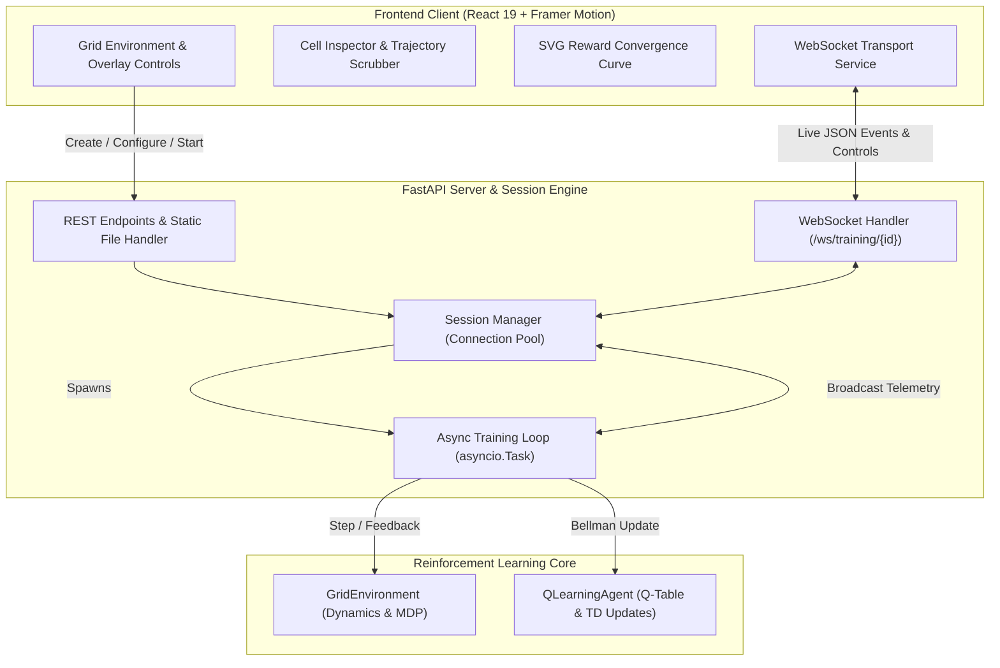

# RL Playground — Q-Learning GridWorld Visualizer & Telemetry Engine

[](https://www.python.org/)
[](https://fastapi.tiangolo.com/)
[](https://react.dev/)
[](https://tailwindcss.com/)
[](https://www.framer.com/motion/)
[](https://vitejs.dev/)
[](https://www.docker.com/)
[](#license)

**RL Playground** is a full-stack, real-time interactive reinforcement learning laboratory designed to make value-based tabular methods transparent, intuitive, and observable. Built with **FastAPI**, **React 19**, and **WebSockets**, it visualizes how an agent explores an environment, updates its state-action value table ($Q$), resolves the exploration-exploitation dilemma, and discovers optimal paths across dynamic grid topologies.

---

## Table of Contents

- [Core Features](#core-features)
- [Mathematical & Algorithmic Foundations](#mathematical--algorithmic-foundations)
- [System Architecture](#system-architecture)
- [Interactive UI Tour](#interactive-ui-tour)
- [WebSocket Protocol Specification](#websocket-protocol-specification)
- [REST API Reference](#rest-api-reference)
- [Codebase Structure](#codebase-structure)
- [Local Development Setup](#local-development-setup)
- [Production Deployment with Docker](#production-deployment-with-docker)
- [Render Deployment Guide](#render-deployment-guide)
- [Hyperparameter Tuning Guide](#hyperparameter-tuning-guide)
- [License](#license)

---

## Core Features

- **Interactive In-Grid Environment Builder:**
  - Place obstacles, reposition the agent's start state, and set goal locations directly via mouse clicks using dedicated toolbar chips (`Agent`, `Goal`, `Wall`, `Erase`).
  - Adaptive grid sizing (from $3 \times 3$ up to $8 \times 8$ or larger in the schema) with responsive cell geometry.

- **Real-Time Visual Overlays:**
  - **Q-Values Overlay:** Displays maximum estimated Q-values inside every state cell in real time.
  - **Policy Direction Arrows:** Visualizes the agent's learned greedy action policy ($\uparrow, \downarrow, \leftarrow, \rightarrow$) dynamically updating as episodes progress.

- **Live Bidirectional WebSocket Streaming:**
  - Zero-polling architecture: step updates, episode metrics, Q-table snapshots, and policy demo animations stream seamlessly over a bidirectional WebSocket channel.
  - Adaptive throttling: adjust step delay from 0ms (turbo background execution) up to 1000ms for slow-motion educational analysis.

- **Deep State/Cell Inspector:**
  - Click any state cell $[r, c]$ to view a granular breakdown of all four cardinal action values ($Q(\text{up}), Q(\text{down}), Q(\text{left}), Q(\text{right})$) complete with visual comparison meters and best-action highlight indicators.

- **Reward Convergence Analytics:**
  - Responsive SVG line chart comparing raw per-episode total rewards against a 20-episode smoothed moving average, visualizing stability and convergence over time.

- **Time-Travel Episode Inspector & Replay Engine:**
  - Jump to any milestone episode (Ep 1, 10, 50, 100, 250, 500) or enter a custom episode index.
  - Interactive step scrubber and automated playback controls with adjustable playback speed.
  - Step-by-step trajectory log indicating exact transitions, actions taken, immediate rewards, and animated path breadcrumbs on the grid.

- **One-Click Greedy Policy Demo:**
  - Test the learned policy without exploration ($\epsilon = 0$) to watch the agent autonomously navigate the optimal trajectory from start to goal.

- **Single-Container Multi-Stage Docker Architecture:**
  - Builds the React client and serves both API endpoints, WebSocket feeds, and the production static SPA bundle from a single unified FastAPI instance.

---

## Mathematical & Algorithmic Foundations

### Markov Decision Process (MDP) Formulation

The GridWorld environment is formalized as a finite Markov Decision Process defined by the 5-tuple $(S, A, P, R, \gamma)$:

1. **State Space ($S$):**
   - Each state $s \in S$ is represented by discrete coordinates $(r, c)$ where $0 \leq r < \text{rows}$ and $0 \leq c < \text{cols}$, excluding obstacle coordinates.

2. **Action Space ($A$):**
   - Four discrete cardinal directions:
     $$A = \{\text{'up'}, \text{'down'}, \text{'left'}, \text{'right'}\}$$

3. **Transition Dynamics ($P$):**
   - Deterministic transitions:
     - $\text{'up'}: (r, c) \rightarrow (r-1, c)$
     - $\text{'down'}: (r, c) \rightarrow (r+1, c)$
     - $\text{'left'}: (r, c) \rightarrow (r, c-1)$
     - $\text{'right'}: (r, c) \rightarrow (r, c+1)$
   - **Boundary & Obstacle Collisions:** Attempting to transition into an obstacle or outside the grid boundary causes the agent to bounce back to its originating cell $s$, receiving a penalty.

4. **Reward Function ($R$):**
   $$R(s, a, s') = \begin{cases} r_{\text{goal}} & \text{if } s' = \text{goal} \\ r_{\text{wall}} & \text{if boundary or obstacle collision} \\ r_{\text{step}} & \text{for any valid non-terminal step} \end{cases}$$
   - Default weights: $r_{\text{goal}} = +100.0$, $r_{\text{step}} = -1.0$, $r_{\text{wall}} = -5.0$.

5. **Discount Factor ($\gamma$):**
   - $\gamma \in [0, 1]$ models the agent's preference for immediate versus future rewards.

---

### Tabular Q-Learning Algorithm

Q-learning is a model-free, off-policy Temporal Difference (TD) control algorithm that learns the optimal state-action value function $Q^*(s, a)$ representing the expected cumulative discounted reward:

$$Q^*(s, a) = \mathbb{E}\left[ \sum_{t=0}^{\infty} \gamma^t R(s_t, a_t, s_{t+1}) \;\middle|\; s_0 = s, a_0 = a, \pi^* \right]$$

#### Bellman Optimality Equation & TD Update Rule

At step $t$, upon executing action $a_t$ in state $s_t$, receiving reward $r_{t+1}$, and observing next state $s_{t+1}$:

$$Q(s_t, a_t) \leftarrow Q(s_t, a_t) + \alpha \cdot \delta_t$$

Where:
- $\alpha \in (0, 1]$ is the **learning rate**.
- $\delta_t$ is the **Temporal Difference Error**:
  $$\delta_t = \underbrace{r_{t+1} + \gamma \max_{a' \in A} Q(s_{t+1}, a')}_{\text{TD Target}} - Q(s_t, a_t)$$
- If $s_{t+1}$ is a terminal state (the goal), $\max_{a'} Q(s_{t+1}, a') = 0$, reducing the TD target strictly to $r_{t+1}$.

---

### Exploration vs. Exploitation ($\epsilon$-Greedy Policy)

To discover high-reward pathways while exploiting known high-value actions, the agent follows an $\epsilon$-greedy policy:

$$\pi(a \mid s) = \begin{cases} 1 - \epsilon + \frac{\epsilon}{|A|}, & \text{if } a = \arg\max_{a' \in A} Q(s, a') \\ \frac{\epsilon}{|A|}, & \text{if } a \neq \arg\max_{a' \in A} Q(s, a') \end{cases}$$

- **Stochastic Tie-Breaking:** If multiple actions share the maximal Q-value (such as initially when all values are zero), the agent uniformly breaks symmetry at random.
- **Exponential Epsilon Decay:** After each episode $k$:
  $$\epsilon_{k+1} \leftarrow \max\left(\epsilon_{\min}, \; \epsilon_k \times \epsilon_{\text{decay}}\right)$$
  *(Defaults: initial $\epsilon = 0.20$, $\epsilon_{\text{decay}} = 0.995$, $\epsilon_{\min} = 0.01$)*

---

## System Architecture



### Concurrency Model & Non-Blocking Design

- **Asynchronous Loop:** Each training session executes in an isolated `asyncio.Task`.
- **Event-Driven Pause/Resume:** Pausing and resuming relies on an `asyncio.Event` flag (`_pause_event.clear()` and `_pause_event.set()`), allowing pause without burning CPU cycles.
- **Event Loop Health:** When training runs at maximum speed (`delay_ms = 0`), the loop yields control to the event loop every 10 episodes via `await asyncio.sleep(0.005)` to ensure ping/pong heartbeats and WebSocket frames remain fully responsive.
- **In-Memory Trajectory History:** Every transition (`step`, `state`, `action`, `reward`, `next_state`, `done`) is logged in memory per session, enabling zero-database instantaneous time-travel replay.

---

## Interactive UI Tour

```
┌────────────────────────────────────────────────────────────────────────┐
│  RL Playground  [● LIVE WS CONNECTED]              Session: 4f1a9c82   │
├────────────────────────────────────────────────────────────────────────┤
│  STATUS: TRAINING [=== 342 / 500 ep (68%) ===]                         │
│  Ep: 342  |  Step: 14  |  Last R: -1.0  |  Avg(20): 88.5  |  ε: 0.036  │
├───────────────────────────────┬────────────────────────────────────────┤
│  GRID ENVIRONMENT             │  CONTROLS & CONFIGURATION              │
│  ┌───┬───┬───┬───┐            │  [Agent] [Goal] [Wall] [Erase]         │
│  │ A │ → │ ↓ │   │            │  [Start] [Pause] [Resume] [Reset]      │
│  ├───┼───┼───┼───┤            │  Speed: [========●===] 30ms            │
│  │   │ ■ │ ■ │ ↓ │            │  ☑ Show Q-Values  ☑ Show Policy Arrows │
│  ├───┼───┼───┼───┤            │  [⚡ Run Policy Demo]                  │
│  │   │ ■ │   │ ↓ │            ├────────────────────────────────────────┤
│  ├───┼───┼───┼───┤            │  CELL INSPECTOR: State [0, 1]          │
│  │   │   │ → │ G │            │  ↑ Up: 42.1     ↓ Down: 78.4 (BEST)    │
│  └───┴───┴───┴───┘            │  ← Left: 38.0   → Right: 65.2          │
├───────────────────────────────┴────────────────────────────────────────┤
│  REWARD CONVERGENCE (SVG)                                              │
│  100 ┼                 ╭────────────────── Avg(20) Reward              │
│    0 ┼    ╭────────────╯                                               │
│ -100 ┼────╯                                                            │
│      └────────────────────────────────────────────────────────────     │
│  EPISODE REPLAY SCRUBBER: [⏮] [▶] [⏭]  Step 7 of 14 (Ep 250)           │
└────────────────────────────────────────────────────────────────────────┘
```

---

## WebSocket Protocol Specification

WebSocket Endpoint: `/ws/training/{session_id}`

### 1. Server-to-Client Messages

| Event `type` | Description | Key Payload Fields |
|---|---|---|
| `init` | Emitted immediately upon connection | `session_id`, `status`, `current_episode`, `agent_position`, `q_table`, `best_actions` |
| `episode_start` | Dispatched at the start of each episode | `episode`, `total_episodes`, `state`, `epsilon` |
| `step` | Dispatched on every action step (when `delay_ms > 0`) | `episode`, `step`, `agent_position`, `action`, `reward`, `done`, `q_values`, `epsilon` |
| `episode_end` | Emitted when an episode terminates | `episode`, `steps`, `episode_reward`, `avg_reward`, `epsilon`, `q_table`, `best_actions` |
| `training_finished` | Emitted when all episodes complete | `total_episodes`, `q_table`, `best_actions`, `final_epsilon` |
| `reset_ack` | Confirms session reset | `agent_position`, `q_table`, `best_actions` |
| `policy_demo_start` | Marks beginning of greedy policy rollout | `start`, `goal` |
| `policy_demo_step` | Each step in the greedy rollout | `step`, `agent_position`, `from_state`, `action`, `reward`, `done` |
| `policy_demo_finished`| Rollout finished | `success`, `total_steps`, `total_reward`, `path` |
| `error` | Emitted on internal error | `message` |

### 2. Client-to-Server Action Commands

Clients can send JSON commands directly over the WebSocket connection:

```json
// Start training
{ "action": "start" }

// Pause training
{ "action": "pause" }

// Resume training
{ "action": "resume" }

// Reset agent, environment, and Q-table
{ "action": "reset" }

// Adjust training delay (ms)
{ "action": "set_speed", "delay_ms": 50 }

// Execute greedy policy demonstration
{ "action": "run_demo", "speed_ms": 220 }
```

---

## REST API Reference

Interactive OpenAPI documentation is automatically served at `/api/docs`.

### Summary Table

| Method | Endpoint | Request Body | Description |
|---|---|---|---|
| `GET` | `/api/health` | None | Service health check |
| `POST` | `/environment/create` | `EnvironmentConfig` | Initialize a new session and environment |
| `POST` | `/training/{id}/start` | None | Launch background training loop |
| `POST` | `/training/{id}/pause` | None | Pause ongoing training |
| `POST` | `/training/{id}/resume` | None | Resume paused training |
| `POST` | `/training/{id}/reset` | None | Reset Q-table, agent, and stats |
| `POST` | `/training/{id}/speed` | `{"delay_ms": int}` | Update step delay duration |
| `POST` | `/training/{id}/demo` | `{"speed_ms": int}` | Trigger greedy policy demo |
| `GET` | `/training/{id}/status` | None | Fetch current session telemetry |
| `GET` | `/training/{id}/q-table` | None | Retrieve serializable Q-table and best actions |
| `GET` | `/training/{id}/episodes` | None | Get summaries of all completed episodes |
| `GET` | `/training/{id}/episode/{n}`| None | Get complete trajectory for episode $n$ |

---

### Request & Response Examples

#### 1. Create Environment & Session
```http
POST /environment/create
Content-Type: application/json

{
  "rows": 4,
  "cols": 4,
  "start": [0, 0],
  "goal": [3, 3],
  "obstacles": [[1, 1], [1, 2], [2, 1]],
  "goal_reward": 100.0,
  "step_penalty": -1.0,
  "wall_penalty": -5.0,
  "alpha": 0.1,
  "gamma": 0.9,
  "epsilon": 0.2,
  "epsilon_decay": 0.995,
  "epsilon_min": 0.01,
  "episodes": 500,
  "max_steps": 100,
  "delay_ms": 30
}
```

**Response (`200 OK`):**
```json
{
  "session_id": "8b3df92a",
  "status": "initialized",
  "config": {
    "rows": 4,
    "cols": 4,
    "start": [0, 0],
    "goal": [3, 3],
    "obstacles": [[1, 1], [1, 2], [2, 1]],
    "goal_reward": 100.0,
    "step_penalty": -1.0,
    "wall_penalty": -5.0,
    "alpha": 0.1,
    "gamma": 0.9,
    "epsilon": 0.2,
    "epsilon_decay": 0.995,
    "epsilon_min": 0.01,
    "episodes": 500,
    "max_steps": 100,
    "delay_ms": 30
  }
}
```

#### 2. Get Episode Trajectory Detail
```http
GET /training/8b3df92a/episode/250
```

**Response (`200 OK`):**
```json
{
  "episode": 250,
  "steps": 6,
  "total_reward": 95.0,
  "epsilon": 0.0568,
  "reached_goal": true,
  "path": [[0, 0], [0, 1], [0, 2], [0, 3], [1, 3], [2, 3], [3, 3]],
  "trajectory": [
    {
      "step": 1,
      "state": [0, 0],
      "action": "right",
      "reward": -1.0,
      "next_state": [0, 1],
      "done": false
    },
    {
      "step": 6,
      "state": [2, 3],
      "action": "down",
      "reward": 100.0,
      "next_state": [3, 3],
      "done": true
    }
  ]
}
```

---

## Codebase Structure

```
Project-001/
├── Dockerfile                      # Production multi-stage build (Node build + Python runtime)
├── .dockerignore                   # Docker exclusion rules
├── readme.md                       # Comprehensive Project-001 documentation (this file)
│
├── backend/                        # FastAPI application & RL core
│   ├── main.py                     # API routes, WebSocket endpoint, SPA static server
│   ├── requirements.txt            # Python dependencies (FastAPI, uvicorn, websockets, pydantic)
│   ├── models/
│   │   └── schemas.py              # Pydantic schemas (EnvironmentConfig, status, Q-table)
│   ├── rl/
│   │   ├── environment.py          # GridEnvironment: transition dynamics, rewards, boundaries
│   │   ├── q_learning.py           # QLearningAgent: Q-table, ε-greedy policy, TD Bellman update
│   │   └── trainer.py              # TrainingSession: async loop, trajectory logging, policy demo
│   └── sessions/
│       └── manager.py              # SessionManager: in-memory store & WebSocket broadcast pool
│
└── frontend/                       # React 19 SPA (Vite + Tailwind CSS v4)
    ├── package.json                # Dependencies: React 19, Lucide, Framer Motion, Axios
    ├── vite.config.js              # Vite bundler configuration
    ├── index.html                  # HTML template with typography imports
    └── src/
        ├── main.jsx                # React root mount
        ├── App.jsx                 # Application state container & layout
        ├── index.css               # Clean minimal theme & grid styles
        ├── services/
        │   └── api.js              # REST API calls & WebSocket client connection factory
        └── components/
            ├── GridEnvironment.jsx # Interactive CSS grid, agent motion, overlay rendering
            ├── ControlPanel.jsx    # Editing tools, start/pause/reset buttons, overlays toggle
            ├── TrainingStats.jsx   # Top status banner, progress bar, real-time metrics
            ├── LearningCurve.jsx   # Scalable SVG reward convergence chart
            ├── CellInspector.jsx   # Deep-dive inspector for state-action values
            ├── ConfigPanel.jsx     # Hyperparameter sliders, reward weights, preset buttons
            └── EpisodeHistory.jsx  # Episode browser, scrubber slider, step-by-step replay
```

---

## Local Development Setup

### Prerequisites

- **Python 3.12+**
- **Node.js 20+**
- **npm** or **yarn**

---

### 1. Backend Server Setup

```bash
# Navigate to the backend directory
cd Project-001/backend

# Create a virtual environment
python3 -m venv venv

# Activate the virtual environment
source venv/bin/activate       # On Windows: venv\Scripts\activate

# Install requirements
pip install -r requirements.txt

# Run the FastAPI server with hot-reload
uvicorn main:app --reload --port 8000
```

- API Base URL: `http://localhost:8000`
- Interactive OpenAPI Docs: `http://localhost:8000/api/docs`
- Health check: `http://localhost:8000/api/health`

---

### 2. Frontend Client Setup

```bash
# Navigate to the frontend directory
cd Project-001/frontend

# Install dependencies
npm install

# Start the Vite development server
npm run dev
```

- Web UI: `http://localhost:5173`

> **Note:** In local development mode, Vite automatically communicates with `http://localhost:8000` for REST API requests and `ws://localhost:8000` for WebSockets. You can override these using environment variables:
> - `VITE_API_URL=http://localhost:8000`
> - `VITE_WS_URL=ws://localhost:8000`

---

## Production Deployment with Docker

The multi-stage `Dockerfile` provides a production-ready container:
- **Stage 1 (`frontend-builder`):** Uses `node:20-alpine` to install dependencies and execute `npm run build`, producing an optimized React bundle in `/dist`.
- **Stage 2 (`runtime`):** Uses `python:3.12-slim`, creates a dedicated non-root user `app`, installs backend Python packages, and copies the compiled frontend assets into `/app/static`. FastAPI serves the React SPA directly.

### Building & Running the Container

```bash
# From within the Project-001 directory:
docker build -t rl-playground .

# Run the container locally mapping port 8000:
docker run -p 8000:8000 rl-playground
```

Access the complete application at `http://localhost:8000`.

---

## Render Deployment Guide

Follow these steps to deploy RL Playground as a live Web Service on [Render](https://render.com):

### Step 1: Push Code to GitHub

Ensure all your latest changes are pushed to your remote repository:

```bash
git add .
git commit -m "feat: complete RL playground visualizer with dockerfile"
git push origin main
```

### Step 2: Create a New Web Service on Render

1. Log in to your [Render Dashboard](https://dashboard.render.com/).
2. Click **New +** → **Web Service**.
3. Select and connect your repository (`RL-proj`).
4. Configure the service settings:

| Setting Field | Value | Notes |
|---|---|---|
| **Name** | `rl-playground` | Choose any preferred service name |
| **Region** | Closest to your users | e.g. Oregon (US West) or Frankfurt (EU) |
| **Root Directory** | `Project-001` | **Crucial:** Directs Render to `Project-001/Dockerfile` |
| **Runtime** | `Docker` | Render automatically builds using the Dockerfile |
| **Dockerfile Path** | `./Dockerfile` | Relative to the Root Directory |
| **Instance Type** | Free or Starter | Free tier includes 512MB RAM |

### Step 3: Environment Variables

Render dynamically assigns and injects the `PORT` environment variable. The `Dockerfile` CMD expands `${PORT}` at runtime:

```dockerfile
CMD uvicorn main:app --host 0.0.0.0 --port ${PORT}
```

No additional environment variables are strictly required.

### Step 4: Deploy and Verify

Click **Create Web Service**. Render will:
1. Pull the repository.
2. Build Stage 1 (Node Vite production build).
3. Build Stage 2 (Python installation and asset assembly).
4. Spin up the container and perform HTTP health checks.
5. Provide a public URL (e.g. `https://rl-playground-xxxx.onrender.com`).

> **Render Free Tier Notice:** On the free tier, services automatically sleep after 15 minutes of inactivity. When a new request arrives, waking up the container takes approximately 30 seconds.

---

## Hyperparameter Tuning Guide

| Parameter | Symbol | Recommended Range | Impact on Training Behavior |
|---|---|---|---|
| **Learning Rate** | $\alpha$ | `0.05` – `0.20` | Determines the magnitude of Q-value updates. Values too high ($> 0.5$) cause oscillation and policy divergence; values too low ($< 0.02$) require thousands of episodes to backpropagate rewards across larger grids. |
| **Discount Factor** | $\gamma$ | `0.85` – `0.99` | Governs the foresight of the agent. Higher values ($\gamma \approx 0.95$) incentivize optimal long-horizon navigation; lower values ($\gamma < 0.5$) make the agent myopic, focusing only on immediate rewards. |
| **Exploration Rate** | $\epsilon$ | `0.10` – `0.50` | Initial probability of taking a random exploratory action instead of following the greedy policy. |
| **Epsilon Decay** | $\epsilon_{\text{decay}}$ | `0.990` – `0.998` | Multiplicative decay rate per episode. Ensures sufficient exploration early in training while gradually annealing to greedy exploitation. |
| **Step Penalty** | $r_{\text{step}}$ | `-0.5` to `-2.0` | Incurs cost per elapsed time step. Strongly motivates finding the shortest path without unnecessary loops. |
| **Wall Penalty** | $r_{\text{wall}}$ | `-2.0` to `-10.0` | Penalizes collisions with grid boundaries and obstacles, teaching the agent safety boundaries. |

---

## License

This project is licensed under the MIT License — see the [LICENSE](../LICENSE) file for details.
