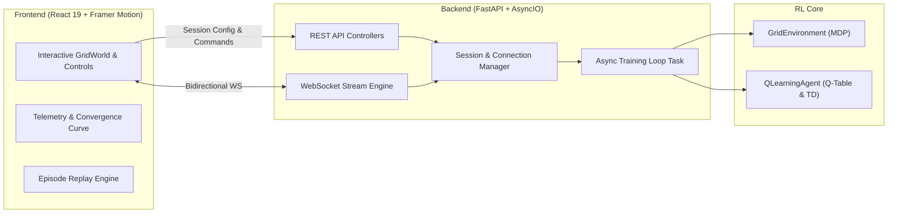

# RL-proj — Reinforcement Learning Projects Suite

[](https://www.python.org/)
[](https://react.dev/)
[](https://fastapi.tiangolo.com/)
[](https://www.docker.com/)
[](#license)

A modular monorepo dedicated to reinforcement learning algorithms, simulation environments, and real-time interactive visualizers. This repository bridges the gap between theoretical RL formulations and practical, transparent software engineering—progressing from fundamental tabular methods to deep reinforcement learning architectures.

---

## Repository Map

```
RL-proj/
├── Project-001/                  # [Active] RL Playground — Q-Learning GridWorld Visualizer
│   ├── backend/                  # FastAPI async engine & RL core
│   │   ├── rl/                   # Environment, Q-learning agent, training loop
│   │   ├── models/               # Pydantic schemas & validation
│   │   ├── sessions/             # In-memory session manager & WebSocket pool
│   │   └── main.py               # REST API & WebSocket endpoints
│   ├── frontend/                 # React 19 SPA (Vite + Tailwind CSS v4 + Framer Motion)
│   │   └── src/components/       # Grid visualizer, telemetry, curve, inspector
│   ├── Dockerfile                # Multi-stage production container
│   └── readme.md                 # Project-specific documentation
│
└── readme.md                     # Root suite documentation (this file)
```

---

## Projects Catalog

| Project ID | Title | Algorithmic Core | State Space | Action Space | Tech Stack | Status |
|---|---|---|---|---|---|:---:|
| **[Project-001](file:///Users/atharvasharna/Desktop/RL-proj/Project-001/readme.md)** | **RL Playground: GridWorld** | Tabular Q-Learning ($\epsilon$-greedy TD) | Discrete 2D Grid ($N \times M$) | Discrete 4-Way (`up`, `down`, `left`, `right`) | Python, FastAPI, WebSockets, React 19, Tailwind CSS | **Completed & Production Ready** |
| **Project-002** | *Deep Q-Networks (DQN)* | Experience Replay & Target Networks | High-Dimensional / Continuous | Discrete Actions | PyTorch, Gymnasium, FastAPI | *Planned* |
| **Project-003** | *Policy Gradients (REINFORCE)* | Monte Carlo Policy Gradients | Continuous / Vector State | Discrete & Continuous | PyTorch, NumPy, WebSockets | *Planned* |
| **Project-004** | *Actor-Critic (PPO / A2C)* | Generalized Advantage Estimation (GAE) | Continuous Environments | Continuous Action Spaces | PyTorch, FastAPI, Three.js | *Planned* |

---

## Spotlight: Project-001 (RL Playground)

[**Project-001**](file:///Users/atharvasharna/Desktop/RL-proj/Project-001/readme.md) is an interactive, full-stack visualizer and training sandbox for tabular Q-learning. It provides real-time transparency into how an agent explores an environment, updates its state-action value table ($Q$), and converges toward the optimal Bellman policy.



### Core Capabilities of Project-001

- **Multi-Agent Reinforcement Learning (MARL) Game Modes:**
  - **Solo Mode (👤):** Single-agent Q-learning across configurable grid environments with stochastic hazards and door/key mechanisms.
  - **Competitive Race Mode (🏁 2-Agent Duel):** Agent 1 (Blue) and Agent 2 (Orange) race head-to-head to reach the goal first, featuring real-time physical collision handling (bounce-back and penalty), duel scoreboards, and dual convergence lines.
  - **Cooperative Team Mode (🤝 2-Agent Team):** Both agents must coordinate to reach individual goals (Goal 1 & Goal 2) to trigger a shared cooperative team bonus.
- **Interactive Environment Builder:** Add obstacles, cliffs, mud, ice, portals, and two-click **Doors & Keys**, reposition agent start states (`Agent 1`, `Agent 2`), and move goals dynamically using direct grid click-and-place tools.
- **Augmented MDP State Space & Multi-Policy Visualization:** When doors exist, state space augments to $(r, c, \text{has\_key})$, featuring a real-time slice selector between `Need Key` and `Has Key` policies, plus per-agent policy toggles for multi-agent games.
- **Web Audio API Synthesizers:** Zero-latency sound synthesizers for steps, goal reached, collision bonks, Agent 1 win fanfare, Agent 2 win fanfare, and team victory chords.
- **Mobile-Responsive UI:** Fluid layouts with touch-friendly controls, adaptive cell geometry down to 320px screens, and side-by-side agent representation within cells.
- **Live Bidirectional Telemetry:** Stream training progress, instant rewards, 20-episode moving averages, and $\epsilon$-decay in real time over native WebSockets.
- **Visual Overlays:** Toggle cardinal Q-values and optimal directional policy arrows ($\uparrow, \downarrow, \leftarrow, \rightarrow$) directly on each grid cell.
- **Time-Travel Episode Replay:** Inspect historical episodes step-by-step with an interactive scrubber, detailed trajectory logs, and animated path playback.
- **Greedy Policy Demonstration:** Watch the agent autonomously navigate the discovered optimal trajectory at human speed.
- **One-Click Presets & Hyperparameter Tuning:** Adjust learning rate ($\alpha$), discount factor ($\gamma$), exploration rate ($\epsilon$), episode caps, and reward penalties on the fly.
- **Single-Container Deployment:** Packaged with a multi-stage Docker build that bundles the built React client directly into the FastAPI server.

---

## Quickstart Guide

### Prerequisites

Ensure you have installed:
- **Python**: version `3.12+`
- **Node.js**: version `20+`
- **Package Managers**: `pip` and `npm`
- **Docker** *(optional, for containerized execution)*

---

### Method 1: Local Development Setup

To run Project-001 locally in dual-server development mode:

#### 1. Backend Server
```bash
# Navigate to Project-001 backend
cd Project-001/backend

# Create and activate a Python virtual environment
python3 -m venv venv
source venv/bin/activate       # On Windows: venv\Scripts\activate

# Install dependencies
pip install -r requirements.txt

# Start the FastAPI server with live reloading
uvicorn main:app --reload --port 8000
```
- **REST API:** `http://localhost:8000`
- **Swagger Documentation:** `http://localhost:8000/api/docs`
- **Health Check:** `http://localhost:8000/api/health`

#### 2. Frontend Client
```bash
# Open a new terminal tab/window
cd Project-001/frontend

# Install dependencies
npm install

# Start Vite development server
npm run dev
```
- **Application UI:** `http://localhost:5173`

---

### Method 2: Docker Containerized Execution

A production-grade, multi-stage `Dockerfile` is provided in `Project-001/`. It builds the React client into static assets and serves both the frontend SPA and FastAPI backend from a single unified container:

```bash
# Navigate to Project-001
cd Project-001

# Build the Docker image
docker build -t rl-playground .

# Run the container
docker run -p 8000:8000 rl-playground
```

Open your browser at `http://localhost:8000` to interact with the full playground.

---

## Engineering & Architectural Principles

1. **Decoupled RL Core:** The reinforcement learning mathematics (environments, agents, state update rules) are implemented as pure, dependency-light Python modules separated from server and transport logic.
2. **Non-Blocking Asynchronous Concurrency:** Training loops run inside dedicated `asyncio.Task` workers. Training execution can be paused, resumed, throttled, or reset using non-blocking synchronization primitives (`asyncio.Event`) without stalling the server's event loop.
3. **Observability First:** Rather than outputting offline terminal logs, training states are streamed as fine-grained JSON events across WebSockets, allowing instant visualization of convergence dynamics.
4. **Resilient Production Packaging:** The multi-stage build creates a zero-node, lightweight Python runtime image executed by a dedicated non-root user, ready for single-click deployment to platforms such as Render, Fly.io, or AWS ECS.

---

## Repository Roadmap

- [x] **Project-001: Tabular Q-Learning GridWorld Visualizer**
  - [x] Real-time WebSocket streaming
  - [x] Custom grid builder & obstacle editor
  - [x] Policy arrows & Q-value overlays
  - [x] Episode history inspector & scrubber replay
  - [x] Multi-stage Docker packaging
- [ ] **Project-002: Deep Q-Networks (DQN) for Classic Control**
  - [ ] CartPole-v1 & LunarLander environments
  - [ ] Target network stabilization and replay buffer visualizer
- [ ] **Project-003: Policy Gradient Methods**
  - [ ] REINFORCE with baseline
  - [ ] Actor-Critic (A2C) on continuous state spaces
- [ ] **Project-004: Proximal Policy Optimization (PPO)**
  - [ ] Clipped surrogate objective visualizer
  - [ ] 3D continuous robotics benchmark

---

## Contributing

Contributions, bug reports, and new project proposals are welcome!
1. Fork this repository.
2. Create your feature branch (`git checkout -b feature/new-rl-environment`).
3. Commit your changes (`git commit -m 'feat: add custom MDP environment'`).
4. Push to the branch (`git push origin feature/new-rl-environment`).
5. Open a Pull Request.

---

## License

This project is licensed under the MIT License — see the [LICENSE](LICENSE) file for details.
