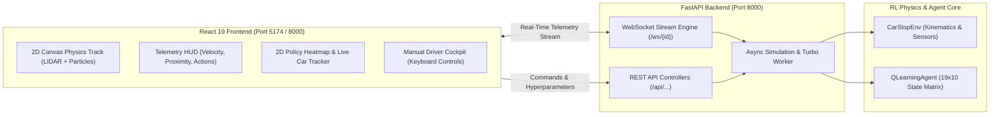

# RL-proj — Reinforcement Learning Projects Suite

[](https://www.python.org/)
[](https://react.dev/)
[](https://fastapi.tiangolo.com/)
[](https://tailwindcss.com/)
[](https://www.docker.com/)
[](#license)

A modular monorepo dedicated to reinforcement learning algorithms, interactive simulation environments, and real-time observability visualizers. This repository bridges the gap between theoretical RL formulations and practical, transparent software engineering—progressing from discrete tabular MDPs to continuous kinematic control and deep reinforcement learning architectures.

---

## 🗺️ Repository Map

```
RL-proj/
├── Project-001/                  # [Active] RL Playground — Q-Learning GridWorld Visualizer
│   ├── backend/                  # FastAPI async engine, MARL core & sessions
│   │   ├── rl/                   # Environment (MDP), Q-agent, async training loop
│   │   ├── models/               # Pydantic schemas & validation
│   │   ├── sessions/             # In-memory session manager & WebSocket pool
│   │   └── main.py               # REST API, WebSocket & static file serving
│   ├── frontend/                 # React 19 SPA (Vite + Tailwind CSS v4 + Framer Motion)
│   │   └── src/components/       # Grid visualizer, telemetry, curve, inspector
│   ├── Dockerfile                # Multi-stage production container for Render / Docker
│   └── readme.md                 # Project-001 documentation
│
├── Project-002/                  # [Active] AutoStop RL — Autonomous 2D Car Braking Playground
│   ├── backend/                  # FastAPI async physics simulation & Q-learning engine
│   │   ├── rl/                   # 2D Kinematics env, tabular Q-agent, state discretization
│   │   ├── models/               # Pydantic schemas for physics, telemetry & hyperparams
│   │   ├── session_manager.py    # Multi-client async session trainer & WebSocket broadcaster
│   │   └── main.py               # REST API, WebSocket streaming & static SPA server
│   ├── frontend/                 # Modern React 19 Light Theme SPA (Vite + Tailwind v4)
│   │   └── src/components/       # 2D Canvas track, LIDAR radar, telemetry HUD, policy heatmap
│   ├── Dockerfile                # Multi-stage production container for 1-click Render deployment
│   ├── .dockerignore             # Clean build exclusions
│   └── readme.md                 # Project-002 comprehensive documentation
│
└── readme.md                     # Monorepo suite documentation (this file)
```

---

## 📚 Projects Catalog

| Project ID | Title | Algorithmic Core | State Space | Action Space | Tech Stack | Status |
|---|---|---|---|---|---|:---:|
| **[Project-001](file:///Users/atharvasharna/Desktop/RL-proj/Project-001/readme.md)** | **RL Playground: GridWorld** | Tabular Q-Learning ($\epsilon$-greedy TD) | Discrete 2D Grid ($N \times M \times \text{has\_key}$) | Discrete 4-Way (`up`, `down`, `left`, `right`) | Python, FastAPI, WebSockets, React 19, Tailwind CSS | **Completed & Production Ready** |
| **[Project-002](file:///Users/atharvasharna/Desktop/RL-proj/Project-002/readme.md)** | **AutoStop RL: 2D Car Braking** | Discretized Tabular Q-Learning | Continuous Kinematics $(d, v) \to 19 \times 10$ Bins | 3 Actions: `Brake`, `Accelerate`, `Maintain` | Python, FastAPI, WebSockets, React 19, Canvas, Tailwind v4 | **Completed & Production Ready** |
| **Project-003** | *Deep Q-Networks (DQN)* | Experience Replay & Target Networks | Continuous / Classic Control (CartPole) | Discrete Action Space | PyTorch, Gymnasium, FastAPI | *Planned* |
| **Project-004** | *Policy Gradients (REINFORCE / PPO)* | Generalized Advantage Estimation (GAE) | Continuous High-Dimensional | Continuous Torque Control | PyTorch, FastAPI, Three.js | *Planned* |

---

## 🚗 Spotlight: Project-002 (AutoStop RL Playground)

[**Project-002**](file:///Users/atharvasharna/Desktop/RL-proj/Project-002/readme.md) is an interactive, light-themed reinforcement learning laboratory where an autonomous 2D car learns to come to an optimal emergency stop right before a rigid barrier.



### Core Capabilities of Project-002
- **2D Physics Simulation & Kinematics**: Forward velocity, braking deceleration ($a = -5.0\text{ m/s}^2$), engine throttle ($a = +2.5\text{ m/s}^2$), and rolling resistance ($a = -0.3\text{ m/s}^2$).
- **Visual Animations**:
  - Headlight beams and **dynamic glowing red brake lights** that flare up whenever brakes are engaged.
  - Nitrous boost particle trails on acceleration and tire friction smoke on braking.
  - **Dynamic Forward LIDAR / Radar Cone**: Forward ray projecting to the barrier with color-coded safety zones (Green > 25m, Amber 10–25m, Crimson < 10m).
  - Celebration confetti on safe stopping; explosion sparks on crash.
- **3 Discrete Actions**: 0 = `Brake`, 1 = `Accelerate`, 2 = `Maintain`.
- **Target Safe Zone**: Safe buffer zone between **$1.0\text{m}$ and $4.0\text{m}$** in front of the barrier ($+150.0$ reward).
- **Interactive Control Modes**:
  - **AI Autopilot**: Watch the trained policy execute optimal emergency braking.
  - **Live Training**: Real-time training loop with $\epsilon$-greedy exploration decay.
  - **Manual Driver Cockpit**: Test human reaction time against the AI using tactile buttons or keyboard shortcuts (`Space`/`B` to Brake, `Up`/`W` to Accelerate, `Down`/`M` to Coast).
  - **Turbo Training**: Train 200 or 1,000 episodes instantly in < 0.25 seconds.
- **Interactive Policy Heatmap**: $19 \times 10$ matrix of Distance ($X$) vs Velocity ($Y$) with cell hover inspection for $Q(\text{Brake})$, $Q(\text{Accelerate})$, $Q(\text{Maintain})$, and a glowing cursor tracking the car's state live.

---

## 🏁 Spotlight: Project-001 (RL GridWorld Playground)

[**Project-001**](file:///Users/atharvasharna/Desktop/RL-proj/Project-001/readme.md) is a full-stack tabular Q-learning sandbox visualizing state-action updates across customizable grid topologies.

- **Game Modes**: Solo Mode, Competitive Duel Mode (2-Agent Race with physical collision handling), and Cooperative Team Mode.
- **Interactive Grid Builder**: Add walls, cliffs, mud, ice, portals, and two-click **Doors & Keys**.
- **Augmented MDP State Space**: Demonstrates state augmentation $(r, c, \text{has\_key})$ with interactive policy slice toggles (`Need Key` vs. `Has Key`).
- **Telemetry & Inspection**: Live cardinal Q-values, directional policy arrows, SVG reward convergence curves, and time-travel episode scrubber.

---

## ⚡ Quickstart Guide

### Prerequisites
- **Python**: version `3.12+`
- **Node.js**: version `20+`
- **Package Managers**: `pip` and `npm`
- **Docker** *(optional, for containerized execution)*

---

### Running Project-002 (Autonomous Car Braking)

#### Option A: Unified Server (FastAPI + Bundled Frontend)
FastAPI serves the backend APIs, WebSockets, and the compiled React SPA simultaneously:
```bash
# 1. Build React frontend
cd Project-002/frontend
npm install
npm run build
rm -rf ../backend/static && cp -r dist ../backend/static

# 2. Run backend
cd ../backend
python3 -m venv venv
source venv/bin/activate
pip install -r requirements.txt
uvicorn main:app --host 0.0.0.0 --port 8000 --reload
```
Open **`http://localhost:8000`** in your browser.

#### Option B: Dual Dev Servers with Hot-Reload
- **Backend**:
  ```bash
  cd Project-002/backend
  source venv/bin/activate
  uvicorn main:app --host 0.0.0.0 --port 8000 --reload
  ```
- **Frontend**:
  ```bash
  cd Project-002/frontend
  npm run dev
  ```
Open **`http://localhost:5174`**.

---

### Running Project-001 (GridWorld Playground)

```bash
# 1. Backend Server
cd Project-001/backend
python3 -m venv venv
source venv/bin/activate
pip install -r requirements.txt
uvicorn main:app --reload --port 8000

# 2. Frontend Client (separate terminal)
cd Project-001/frontend
npm install
npm run dev
```
Open **`http://localhost:5173`**.

---

## 🐳 Docker & 1-Click Deployment on Render

Both `Project-001` and `Project-002` feature self-contained, multi-stage production Dockerfiles:
- **Stage 1 (node:20-alpine)**: Installs npm dependencies and compiles optimized static assets.
- **Stage 2 (python:3.12-slim)**: Installs Python dependencies, copies backend code and static assets, runs as a secure non-root user, and binds `uvicorn` to `$PORT`.

### Local Docker Testing
```bash
# For Project-002:
cd Project-002
docker build -t autostop-rl .
docker run -p 8000:8000 -e PORT=8000 autostop-rl
```

### 1-Click Render Deployment
1. Connect your GitHub repository to [Render](https://dashboard.render.com/).
2. Click **New → Web Service**.
3. Choose the project folder as **Root Directory** (`Project-002` or `Project-001`).
4. Set **Environment** to `Docker` and **Dockerfile Path** to `Dockerfile`.
5. Click **Deploy Web Service**! Render will automatically build the container and deploy the app.

---

## 🛣️ Repository Roadmap

- [x] **Project-001: Tabular Q-Learning GridWorld Visualizer**
  - [x] Multi-agent competitive and cooperative modes
  - [x] Augmented state space with Door & Key mechanics
  - [x] Time-travel episode scrubber and historical replay
  - [x] Multi-stage Docker packaging
- [x] **Project-002: AutoStop RL — Autonomous 2D Car Braking Playground**
  - [x] 2D Kinematics physics with braking, throttle, and drag
  - [x] Continuous state discretization ($19 \times 10$ bins)
  - [x] Dynamic visual effects (headlights, tail brake lights, nitrous particles, LIDAR ray)
  - [x] Interactive policy heatmap with live car state tracker
  - [x] Playable manual driving cockpit with keyboard shortcuts
  - [x] Multi-stage Docker packaging for 1-click Render deployment
- [ ] **Project-003: Deep Q-Networks (DQN) for Classic Control**
  - [ ] CartPole-v1 & LunarLander environments
  - [ ] Target network stabilization and replay buffer visualizer
- [ ] **Project-004: Policy Gradient Methods (REINFORCE / PPO)**
  - [ ] Continuous action spaces and torque control
  - [ ] Clipped surrogate objective visualizer

---

## 📄 License

This project is licensed under the MIT License — see the [LICENSE](LICENSE) file for details.
